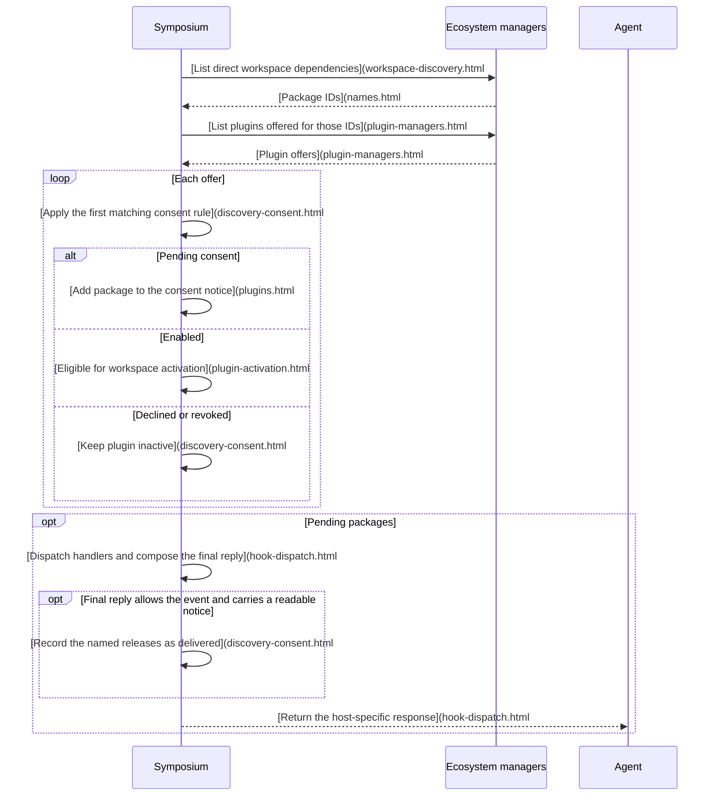

# Dependency discovery and consent

Suppose `my-app` depends on `widget`. Cargo reports that dependency, and Symposium asks the ecosystem managers for plugin offers. If Cargo finds a plugin embedded in `widget`, its offer identifies the package and supplies the manifest and content directory. These are the [discovery queries](plugin-managers.md#A-pm-offers).

> **`A-flow-consent`** (draft): **A pending dependency offer reaches the session as a notice awaiting the user’s decision**
> Property: During discovery Symposium compares offers against revocations and user choices. A pending plugin may be named in the agent’s context. Its offer alone grants no permission to run it.
> Authority: `R-plugins`
> - Criterion `pending` [test]: Open a session with an undecided dependency plugin. Observe a notice naming the package, pointing to `symposium use`, and directing the agent to leave the decision to the user.

<figure class="chapter-diagram" data-anchor="A-flow-consent">

<figcaption><a href="#A-consent-record">How Symposium remembers the user’s decision</a></figcaption>
</figure>

In a session-start hook, an undecided offer reaches the agent as context. The user can run an interactive `symposium sync` to review pending offers or explicitly select a package with `symposium use`. During discovery, an existing decision determines whether an offer is pending, enabled, or declined. A [revocation](plugins.md#A-plugin-revocation) withholds a matching package even after approval.

> **`A-consent-record`** (draft): **Symposium records the user’s answer for later discovery and sync**
> Property: Approving a dependency offer records its package name in `auto-enable`. Declining records it in `disable`. Future discovery uses that decision, and sync can install the approved package’s applicable contributions.
> Authority: `R-plugins`
> - Criterion `remember` [test]: Approve `crate-a`, sync, and observe its installed skill and an empty pending list. Decline another dependency and inspect the saved disable entry.

For later workspace changes, [the package ID determines which releases can be named again](#A-notice-release).

An enabled plugin’s [predicates](predicates.md#A-predicate-expressions) determine which contributions apply. A session handler that passes its gates enters [hook dispatch](hook-dispatch.md).

> **`A-offer-precedence`** (draft): **The first matching consent rule decides each dependency offer**
> Property: Symposium declines an offer whose package identity it cannot resolve. For a resolved offer, the first match wins: `disable` (declined), revocation (revoked), `use` (explicitly enabled), then `auto-enable` (automatically enabled). With no match, the offer stays pending even if it has a positive audit.
> Authority: `R-plugins`
> - Criterion `identity` [test]: Have the manager return an unusable name comparison. Observe that explicit use and auto-enable cannot grant the package access.
> - Criterion `revoked` [test]: Revoke an offered release. Explicit use and auto-enable both yield to revocation. Adding a disable entry yields a decline.
> - Criterion `grants` [test]: Combine `auto-enable` with explicit use or with disable and observe used or declined, respectively.
> - Criterion `pending` [test]: Offer an audited release with no user grant and observe it remains a candidate.

> **`A-notice-delivery`** (draft): **Only the final reply can mark a dependency notice delivered**
> Property: Symposium records delivery when the final reply carries the notice in a form the calling agent can read and allows the event to proceed. Otherwise a later workspace change can surface the offer again.
> Authority: `R-plugins`
> - Criterion `final-reply` [test]: Block a prompt or use an event whose agent cannot read the notice. A later change surfaces the package again. Lift the block before the reply and the delivered package is suppressed.

> **`A-notice-release`** (draft): **Mid-session notices name each pending package release once**
> Property: After delivery, later workspace changes suppress the same package ID. A newly observed version of that package can be named again.
> Authority: `R-plugins`
> - Criterion `release` [test]: Change an unrelated dependency, add another pending package, and change a previously reported package’s version. Observe which releases are named after each change.
