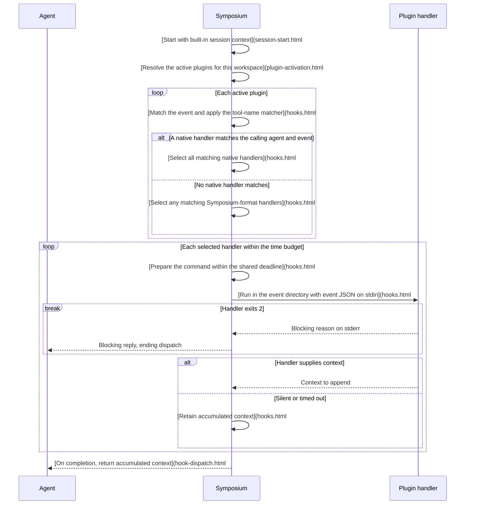

# Hook dispatch

The calling agent sends one event. Symposium resolves the [active plugins and their references](plugin-activation.md#A-flow-activation), then matches handlers by event, agent, matcher, and predicates. Within each plugin, eligible native handlers take precedence over portable handlers. The [selection anchor](hooks.md#A-hook-selection) shows how the same plugin can run different handlers for Claude and Copilot.

> **`A-flow-dispatch`** (draft): **Session-start handlers run in order. Exit 2 blocks the event, otherwise the agent receives their combined context**
> Property: Symposium starts with its built-in context, selects eligible handlers per active plugin, and runs them in sequence. On ordinary completion it returns their context in dispatch order. A handler that exits 2 ends dispatch with the host’s blocking response.
> Authority: `R-events`
> - Criterion `joined-context` [test]: With a pending dependency and two handlers that add text, observe the consent notice followed by both messages. A final silent handler preserves them.

<figure class="chapter-diagram" data-anchor="A-flow-dispatch">

<figcaption><a href="#A-dispatch-stdout">How the hook command returns the reply</a></figcaption>
</figure>

For each selected handler, Symposium [prepares its command](installation.md#A-installation-setup) and supplies the event on stdin in the selected format. During session start, a silent handler preserves earlier context. A timeout [stops the handler’s child commands on Unix](hooks.md#A-hook-timeout-children) and leaves the remaining handlers eligible within the [shared time budget](hooks.md#A-hook-budget). An explicit exit 2 stops the sequence and the adapter returns the blocking reason.

> **`A-dispatch-stdout`** (draft): **The hook command reserves stdout for the calling agent’s response**
> Property: Sync progress stays off the hook’s stdout. The adapter writes the response in the form the calling agent consumes, including plain context for Kiro and JSON for Claude.
> Authority: `R-events`
> - Criterion `response` [test]: Invoke the hook binary with session-start sync enabled. Read the consent notice in Kiro’s plain output and in the other tested agents’ JSON replies.

The [session-start walkthrough](session-start.md) follows a pending package and three handler messages into one Claude reply. For tool events, [hook results](hooks.md#A-hook-results) and the [agent output anchor](agents.md#A-agent-output) describe how a denial reaches the calling agent.
