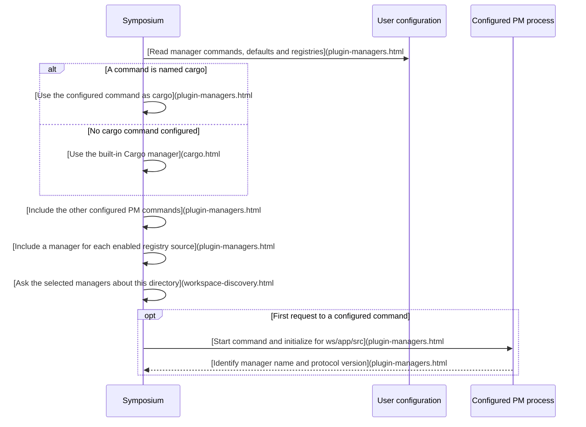

# Choosing the plugin managers

An agent starts a session in `ws/app/src`. Before any manager can answer “what project is here?”, Symposium constructs the manager set for that directory. The same choices apply when the directory contains no Rust project. Whether Cargo recognizes a workspace is a later question.

> **`A-flow-managers`** (draft): **Symposium chooses the managers for a workspace before querying them about the project**
> Property: Symposium selects an in-process Cargo manager unless configuration names a `cargo` command. It includes the other configured manager commands and named registry instances. A configured command starts on its first request and must identify itself before answering. The resulting manager set serves the workspace queries for this invocation.
> Authority: `R-ecosystems`
> - Criterion `configured-cargo` [test]: Configure `symposium-pm-cargo` under the name `cargo`. Observe exactly one manager of that name and obtain the workspace root and its `widget` dependency through it.

<figure class="chapter-diagram" data-anchor="A-flow-managers">

<figcaption><a href="workspace-discovery.html#A-flow-workspace">Follow the first workspace query into a Rust project</a></figcaption>
</figure>

For example, a configured `cargo` executable and a `team` path registry give Symposium two distinct sources of answers. `cargo` can identify dependencies that embed plugins. `team` can list its curated entries even with an empty dependency list. Enabled defaults can also supply the `symposium-recommendations` Git registry and, when the user’s plugin directory exists, the `user-plugins` path registry. See [path entries](path.md#A-path-entries) and [Git checkout discovery](git.md#A-git-registry).
