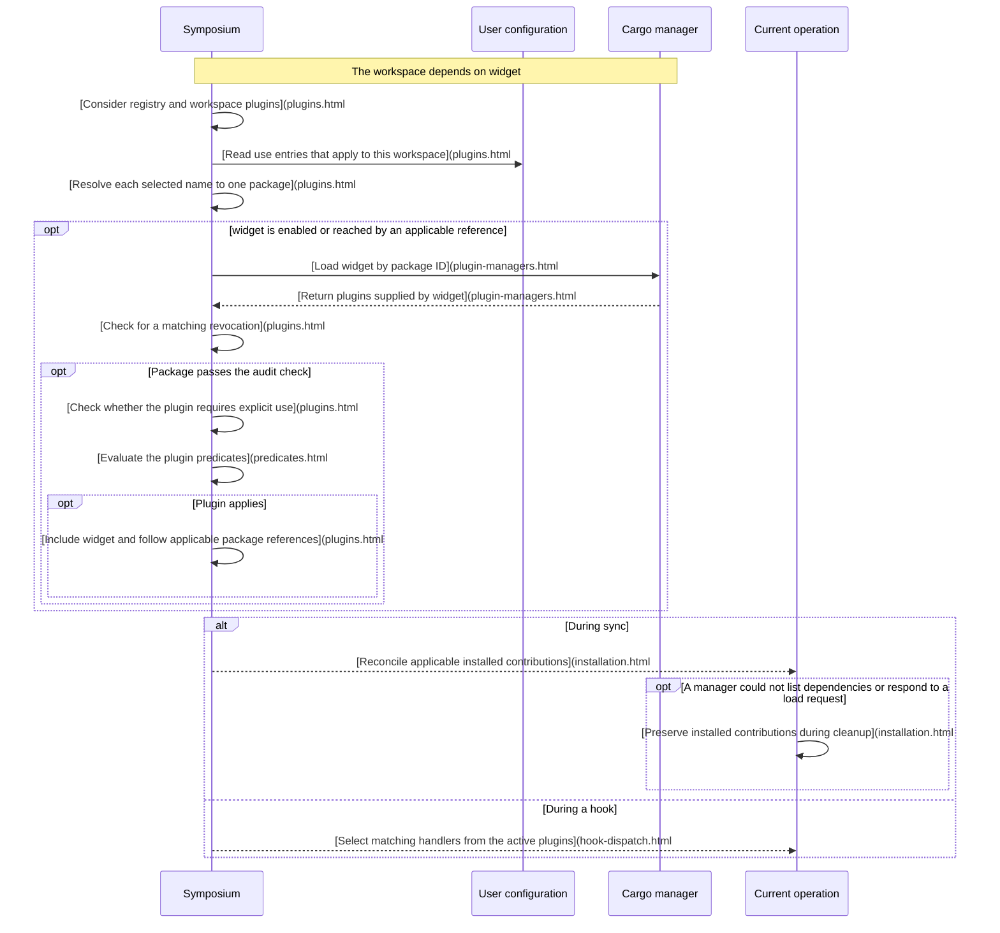

# Activating a plugin

A plugin is **active** when Symposium has selected it for the current workspace and its plugin-level conditions hold. Its skills, hooks, MCP servers, and subcommands can then be considered. Each contribution still has its own conditions. For example, `widget` can be active while none of its hooks match `SessionStart`.

> **`A-flow-activation`** (draft): **Sync and hook dispatch check each plugin’s activation conditions before using its contributions or following its references**
> Property: Symposium starts with plugins from configured registries and the workspace root and members. It also loads enabled packages through their owning managers and follows applicable package references from active plugins. A reached package can be withheld by revocation. Each plugin must pass its own predicates and any explicit-use requirement before its contributions or references are considered.
> Authority: `R-plugins`
> - Criterion `contributions` [test]: Approve the fixture dependency and sync. Observe its installed skill and MCP server, dispatched hook, and available subcommand.
> - Criterion `explicit-use` [test]: Select a dormant registry plugin with `use`, then remove that selection. Observe its skill appear and disappear.

<figure class="chapter-diagram" data-anchor="A-flow-activation">

<figcaption><a href="hook-dispatch.html#A-flow-dispatch">Follow an active plugin into hook dispatch</a></figcaption>
</figure>

In the [Rust workspace example](workspace-discovery.md#A-flow-workspace), suppose `widget` is reachable only as a direct dependency. While consent is pending, its offer can appear in a session notice. Once the user approves it, sync can load it and install the `usage` skill if its conditions hold. Hook dispatch resolves the active set using locally available package content and checks each handler against the incoming event. The [consent record](discovery-consent.md#A-consent-record) persists across invocations. Symposium evaluates applicability in the workspace of each invocation.
