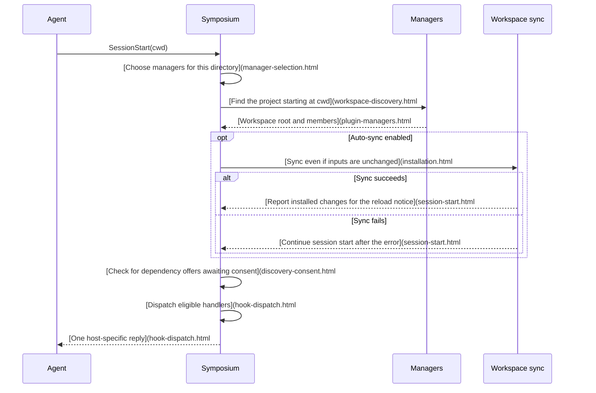

# Session start

Claude Code opens a session in `context-merge-host`, a Rust project that directly depends on `crate-a`. The crate ships a skill, and the user has yet to enable its plugin. Separately, the user’s configured registry contains plugins with session-start handlers. What runs, and what reaches Claude before the first prompt?

The `context-merge0` example has auto-sync off. The diagram also shows where sync runs when enabled.

> **`A-flow-session`** (draft): **Session start runs enabled auto-sync before plugin hooks and continues if sync fails**
> Property: Symposium finds the workspace from the event’s working directory. With auto-sync enabled, it attempts sync even when recorded workspace inputs are fresh. With auto-sync disabled or a sync error, it continues to built-in notices and plugin dispatch.
> Authority: `R-events`
> - Criterion `fresh-inputs` [test]: After a successful sync, remove an installed skill and leave the lockfile unchanged. Open a session and observe the skill restored.

<figure class="chapter-diagram" data-anchor="A-flow-session">



<figcaption><a href="#A-session-reload">When the agent receives reload instructions</a></figcaption>
</figure>

> **`A-session-reload`** (draft): **Session start gives the agent reload instructions for plugins its sync installed or updated**
> Property: When session-start sync installs or updates a plugin for the calling agent, the reload notice names the plugin and gives that agent’s reload action. An unchanged installation produces no reload notice.
> Authority: `R-adapters`
> - Criterion `changed-plugin` [test]: Start sessions before and after editing an installed plugin. Observe reload instructions on install and update, and none on an unchanged session.

1. **Claude calls Symposium.** Claude’s hook configuration points `SessionStart` at `symposium hook claude session-start`. It starts that command and writes its event JSON, including `cwd`, to stdin. Plugin authors register handlers in their manifests. Claude calls Symposium once and receives one reply.

2. **Symposium finds the project the agent is working in.** Before reading stdin, the CLI checks configured registries that allow automatic refresh and refreshes the configured audits list. These checks are best-effort and also happen with auto-sync off. With binary auto-update set to `on`, the CLI may update and restart itself here. The Claude adapter then parses the event, keeps the native payload, and produces Symposium’s `SessionStart` event with the session ID and working directory. Symposium asks managers about the project starting at that directory, using its process directory if the payload omits `cwd`. The managers that find a project must agree on its root. Cargo identifies the local members and reports `crate-a` among their direct dependencies. The hook shares those workspace answers across sync, discovery, and dispatch.

3. **With auto-sync enabled, Symposium updates installed contributions before dispatch.** In a recognized workspace it syncs even when `Cargo.lock` and the other recorded inputs are unchanged. It reads registry and workspace plugins, loads enabled packages through their owning managers, follows applicable plugin references, and evaluates which contributions apply. It reconciles installed skills, plugins, hook registrations, and MCP entries for the configured agents. It can fetch package content during this sync. A successful sync records the workspace inputs and dependencies. Symposium also tries to refresh already-installed tools used by applicable hooks, including hooks for later events. A tool’s first installation can wait until its hook runs. A sync error is logged and hook processing continues. A [manager failure during sync](installation.md#A-sync-manager-failure) also affects whether sync removes old contributions. In the example, auto-sync is off, so processing goes straight to the notices and handlers.

4. **Symposium prepares its own session context.** See [Dependency discovery and consent](discovery-consent.md). It asks ecosystem managers what plugins they offer for the workspace dependencies. Cargo finds the plugin embedded in `crate-a`. The user’s settings leave it awaiting consent, so Symposium names it in a notice and points the user to `symposium sync` or `symposium use`. If an audit answer is available, the notice includes it. The hook never prompts on stdin or grants consent. Other independent notices appear when applicable: `symposium --help` for available plugin subcommands, `symposium self-update` when a warning-mode check finds an update, and agent-specific reload instructions when this sync installed or updated a plugin for the calling agent.

5. **Symposium selects the handlers for this session.** The pending `crate-a` plugin supplies the subject of Claude’s notice. The handlers come from other [active plugins](plugin-activation.md#A-flow-activation). Each plugin makes its own [native-or-portable choice](hooks.md#A-hook-selection), so Claude can receive both formats in one invocation.

6. **The handlers run in order.** The `first` and `second` plugins return portable context, the third returns plain text from a Claude handler, and the last stays silent. Each receives the event on stdin and runs in the [event directory](hooks.md#A-hook-directory) when it exists. [Hook dispatch](hook-dispatch.md#A-flow-dispatch) covers setup, the shared deadline, and what happens if a handler blocks the event.

7. **Claude gets one response.** On the successful example path, `hookSpecificOutput.additionalContext` contains the `crate-a` notice, then `first plugin context`, `second plugin context`, and `third plugin plain text`. The silent handler leaves that accumulated text intact. The Claude adapter also requests a skill rescan with `reloadSkills`. Sync progress stays off stdout so Claude can parse the reply. Symposium records which pending packages it reported only when the outgoing response carries the notice and does not block the event. The [delivery rule](discovery-consent.md#A-notice-delivery) and the [package release recorded](discovery-consent.md#A-notice-release) determine which notices recur. A new `SessionStart` can report still-pending packages again.

## Try two observations

From the repository root, run the fixture that checks context order across agent adapters. Then run the auto-sync fixture, which removes an installed skill after recording a fresh workspace and checks that `SessionStart` restores it.

```sh
cargo nextest run -p symposium -E 'test(=session_start_keeps_symposium_and_plugin_context)'
cargo nextest run -p symposium -E 'test(=auto_sync_always_runs_on_session_start)'
```

## Review questions

The [manager](plugin-managers.md), [plugin](plugins.md), and [hook](hooks.md) chapters cover the individual operations. To probe how they work together:

- **Which workspace does an agent event act on?** Launch the process in one project and send a payload naming another. The selected plugins, relative predicate checks, and handler working directory reveal which directory each stage used.
- **What does opening a session authorize Symposium to do?** The same pending dependency can trigger a notice with auto-sync on or off. Enabling auto-sync can repair an installed skill even with unchanged dependencies. Those are independently observable decisions about consent and refresh.
- **What does the agent receive when several participants answer?** Put one built-in notice, two handlers that add text, and a silent handler in a session. Check the final agent response. Then make a handler exit 2 and check both the blocking reply and whether Symposium records the notice as delivered.
