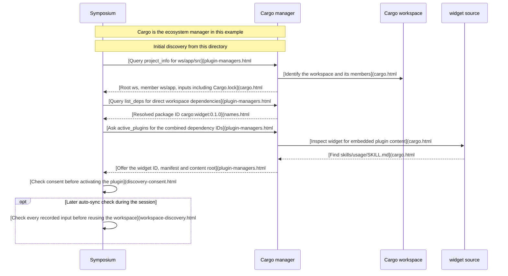

# Discovering a Rust workspace

Suppose you open an agent session in `ws/app/src`. The workspace manifest at `ws/Cargo.toml` lists `app` as a member. The app directly depends on a path crate, `widget` version `0.1.0`, outside `ws`. The crate ships `skills/usage/SKILL.md`. What makes that skill show up as a pending plugin?

> **`A-flow-workspace`** (draft): **Cargo’s workspace answers identify the dependencies Symposium can ask it about for plugin offers**
> Property: Starting at the event directory, Symposium combines the selected managers’ project reports. In a Cargo workspace, `project_info` supplies the root, member directories and change-detection inputs. `list_deps` supplies resolved direct dependency IDs across members. During dependency discovery Cargo inspects locally available sources for the Cargo IDs in the combined list and offers the packages that embed plugin content.
> Authority: `R-ecosystems`
> - Criterion `embedded-skill` [test]: In a workspace containing `app`, make `widget` a direct path dependency with `skills/usage/SKILL.md`. Ask Cargo for the project, dependencies and offers. Observe the `app` member, a `Cargo.lock` input, a Cargo ID for `widget`, and the skill under the offered content root.

<figure class="chapter-diagram" data-anchor="A-flow-workspace">

<figcaption><a href="discovery-consent.html#A-flow-consent">Follow the widget offer through consent</a></figcaption>
</figure>

Three changes to the example expose the boundaries of the flow.

- Remove `skills/usage/SKILL.md` and leave `widget` with no other plugin content. Cargo still reports `widget` in `list_deps`. Its answer to `active_plugins` now contains no offer for `widget`.
- Move `widget` one level down the dependency graph so that only another dependency uses it. Cargo leaves it out of the workspace’s direct dependency IDs. [Cargo membership and direct dependencies](cargo.md#A-cargo-workspace)
- Start outside every recognized project. The managers can report no root, and dependency discovery yields no candidates. With several managers, those reporting a root must agree before Symposium can use it. [Workspace agreement](plugin-managers.md#A-pm-workspace)

> **`A-workspace-freshness`** (draft): **A saved workspace answer is fresh only while every recorded input is unchanged**
> Property: During a mid-session auto-sync check for the same starting directory, Symposium can reuse the last synced root, members, and dependencies when at least one input was recorded and every recorded path has the same presence and modification time. Otherwise it must rediscover the workspace when it needs that answer.
> Authority: `R-ecosystems`
> - Criterion `inputs` [test]: Check the saved answer with zero inputs, an unchanged input, a modified input, and a file that appears or disappears.
> - Criterion `hook` [test]: Repeat a hook with unchanged inputs and observe no package manager starts. Create a nested Cargo workspace and observe the next hook install its skill there.
